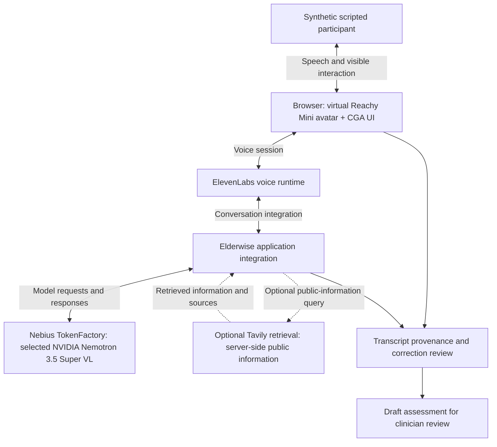

# Elderwise · Nebius demo

**DOCUMENTATION ONLY.** This repository contains an original project description and architecture diagram for the Elderwise Nebius hackathon demo. It does not contain a runnable application or the proprietary implementation. It does not satisfy a requirement to publish runnable source code.

[Open the hosted demo](https://cga.elderwise.ai/voice-assessment-demo)

Elderwise explores a voice interface for comprehensive geriatric assessment, or CGA. The browser combines a virtual Reachy Mini avatar with an assessment UI. A synthetic, scripted demonstration shows a conversation progressing toward a draft for clinician review. It is a software demo, not a demonstration of a physical robot or evidence of clinical validation.

## Architecture

The diagram describes the demo's integration roles at a conceptual level. It omits proprietary implementation details.

| Component | Role in the demo |
| --- | --- |
| Virtual Reachy Mini | Browser avatar that gives the voice interaction a visible presence. No physical robot is claimed. Third-party robot models and assets are not included here. |
| CGA UI | Presents the assessment conversation and draft review workflow. |
| ElevenLabs | Voice runtime for the spoken interaction. |
| NVIDIA Nemotron via Nebius TokenFactory | Selected model integration for the demo's conversational processing. The configured model is Nemotron 3.5 Super VL. |
| Tavily | Optional server-side retrieval of public information to support the conversation. It is not a source of patient facts. |
| Clinician review | Destination for the draft output. The demo does not establish that an output is clinically correct or ready for care decisions. |

## Transcript provenance and corrections

The demonstration uses synthetic scripted material, not real patient records. A scripted line, a speech-recognition transcript, a user correction and a generated summary are different kinds of evidence. Review should preserve those distinctions. A correction should be explicit rather than silently treated as the original spoken statement. Retrieved public information should remain distinguishable from participant statements.

This documentation describes that provenance and correction workflow without publishing transcripts, personal information or implementation details. Draft output requires clinician review and must not be presented as a validated assessment.

## Repository scope

The public files were written for this documentation repository. No application source, private Git history, credentials, patient data, deployment configuration or third-party Reachy Mini assets are included. The hosted demo is separate from this repository. There are no installation or build instructions because these files are not a runnable implementation.

## License

The [MIT license](LICENSE) applies solely to the original files in this repository, copyright 2026 Volodymyr Iermolaiev. It does not license the proprietary Elderwise implementation, hosted services, third-party products, model weights, trademarks or robot assets. Those remain subject to their respective owners' terms.
